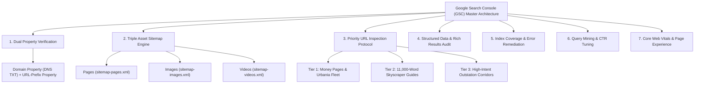

# Sushi Travels — SEO Strategy (2026-08-16, corrected 2026-08-17)

This document is the written strategy deliverable accompanying the technical/
on-page SEO build described in `NOTES.md` section 9. Everything in this file
is documentation for the owner to review and action — none of it (backlinks,
Google Business Profile, blog content) was or could be executed as part of
the code pass, since it requires accounts, relationships and manual work the
codebase change itself can't perform.

**2026-08-17 correction note:** a follow-up SEO/technical audit
(`NOTES.md` section 11) found that several core pages' actual `<h1>` text
didn't literally contain the "Primary Keyword" listed below — see the
per-page notes added inline under the Core Pages table. Five of those were
fixed (H1 text now contains the keyword); the homepage's H1 was deliberately
left generic, as explained inline, to avoid cannibalizing `/fleet` and
`/vehicles/*` for the same keyword. The keyword *assignments* themselves
(which URL owns which phrase) are unchanged and still the working baseline —
only the "does the H1 literally say this" claim has been corrected to match
reality.

All guidance here follows the brief's rules: no keyword stuffing, no fake
reviews/ratings/locations, no invented pricing, no unproven superlative
claims ("#1", "cheapest", "guaranteed lowest", "government approved"), and
white-hat only (no PBNs, link farms, or paid link schemes).

---

## (a) Keyword Map — Page → Primary Keyword → Supporting Keywords

### Core pages (existing)

| Page | Primary Keyword | Supporting Keywords | H1 matches keyword? |
|---|---|---|---|
| `/` (Home) | Car & Tempo Traveller rental Bangalore | Sushi Travels, chauffeur-driven car rental India, outstation cab Bangalore | **No, intentionally.** H1 is "Your Trusted Travel Partner Across India" — kept generic on purpose so the homepage doesn't compete with `/fleet` and `/vehicles/*` for this exact phrase (see `NOTES.md` section 9's cannibalization check). The keyword does appear in the hero subtitle directly beneath the H1. |
| `/fleet` | Tempo Traveller rental Bangalore (9/12/17 seater) | vehicle hire with driver Bangalore, sedan/SUV/bus rental Bangalore | Yes — H1 is now "Tempo Traveller Rental Fleet in Bangalore" (fixed 2026-08-17; was "Explore Our Rental Fleet"). |
| `/tours-and-packages` | Bangalore holiday packages | Mysore/Coorg/Ooty tour package, round trip packages Bangalore | Yes — H1 is now "Bangalore Holiday Tour Packages" (fixed 2026-08-17; was "Tours & Packages"). |
| `/about` | About Sushi Travels | Bangalore travel agency, chauffeur service company | Yes — H1 is now "About Sushi Travels — Our Story & Values" (fixed 2026-08-17; was "Our Story & Values"). |
| `/contact` | Contact Sushi Travels | Sushi Tours & Travels Bangalore phone number | Yes — H1 is now "Contact Sushi Travels" (fixed 2026-08-17; was "Connect With Us"). |
| `/booking` | Book a cab / vehicle Bangalore | online vehicle booking Bangalore | Yes — H1 is now "Book a Vehicle with Driver in Bangalore" (fixed 2026-08-17; was "Chauffeur Rental Booking Center"). |

### Vehicle pages (`/vehicles/[slug]`)

| Page | Primary Keyword | Supporting Keywords |
|---|---|---|
| `sedan-rental-bangalore` | Sedan rental Bangalore with driver | Etios rental Bangalore, Dzire rental Bangalore, airport sedan Bangalore |
| `innova-rental-bangalore` | Innova rental Bangalore | Toyota Innova with driver Bangalore, 7 seater SUV rental |
| `innova-crysta-rental-bangalore` | Innova Crysta rental Bangalore | premium SUV rental Bangalore, corporate Innova Crysta hire |
| `tempo-traveller-rental-bangalore` | 12 seater Tempo Traveller rental Bangalore | AC Tempo Traveller Bangalore, Non-AC Tempo Traveller hire |
| `9-seater-luxury-tempo-traveller-bangalore` | 9 seater luxury Tempo Traveller Bangalore | executive Tempo Traveller hire, 9+1 seater van rental |
| `force-urbania-12-seater-maharaja-bangalore` | Force Urbania 12 seater rental Bangalore | Urbania Maharaja hire, premium van rental Bangalore |
| `force-urbania-16-seater-luxury-bangalore` | Force Urbania 16 seater rental Bangalore | luxury van rental Bangalore, wedding van hire |
| `25-seater-mini-bus-rental-bangalore` | 25 seater mini bus rental Bangalore | mid-size bus hire Bangalore, group bus rental |
| `50-seater-bus-rental-bangalore` | 50 seater bus rental Bangalore | large group bus hire Bangalore, corporate event bus |
| `bus-rental-bangalore` | Bus for rent in Bangalore | bus rental Bangalore, mini coach hire Bangalore, AC bus rental with driver |

### Service pages (`/services/[slug]`)

| Page | Primary Keyword | Supporting Keywords |
|---|---|---|
| `bangalore-airport-taxi` | Bangalore airport taxi | Kempegowda airport cab, BLR airport pickup drop |
| `outstation-cab-bangalore` | Outstation cab service Bangalore | round trip cab Bangalore, outstation taxi booking |
| `local-taxi-bangalore` | Local taxi service Bangalore | hourly cab Bangalore, city taxi hire |
| `corporate-transport-bangalore` | Corporate transport Bangalore | employee transport service, executive car rental |
| `wedding-vehicle-rental-bangalore` | Wedding vehicle rental Bangalore | wedding car hire, guest transport for weddings |
| `bangalore-sightseeing-cab` | Bangalore sightseeing cab | city tour taxi Bangalore, day trip cab rental |

### Location pages (`/locations/[slug]`)

| Page | Primary Keyword | Supporting Keywords |
|---|---|---|
| `car-rental-whitefield` | Car rental Whitefield Bangalore | cab service Whitefield, Whitefield airport taxi |
| `car-rental-electronic-city` | Car rental Electronic City Bangalore | Electronic City cab service, corporate travel Electronic City |
| `car-rental-koramangala` | Car rental Koramangala Bangalore | Koramangala taxi service, Koramangala outstation cab |
| `car-rental-indiranagar` | Car rental Indiranagar Bangalore | Indiranagar cab service |
| `car-rental-jayanagar` | Car rental Jayanagar Bangalore | Jayanagar taxi service, Jayanagar pilgrimage cab |
| `car-rental-jp-nagar` | Car rental JP Nagar Bangalore | JP Nagar cab service |
| `car-rental-marathahalli` | Car rental Marathahalli Bangalore | Marathahalli taxi service, ORR cab service |
| `car-rental-hebbal` | Car rental Hebbal Bangalore | Hebbal airport taxi |
| `car-rental-yelahanka` | Car rental Yelahanka Bangalore | Yelahanka airport cab |
| `car-rental-yeshwanthpur` | Car rental Yeshwanthpur Bangalore | Yeshwanthpur railway station taxi |

### Route pages (`/routes/[slug]`)

| Page | Primary Keyword | Supporting Keywords |
|---|---|---|
| `bangalore-to-mysore-cab` | Bangalore to Mysore cab | Bangalore Mysore taxi fare, Mysore day trip cab |
| `bangalore-to-coorg-cab` | Bangalore to Coorg cab | Bangalore Coorg taxi, Coorg round trip cab |
| `bangalore-to-ooty-cab` | Bangalore to Ooty cab | Bangalore Ooty taxi, Ooty Tempo Traveller |
| `bangalore-to-chikmagalur-cab` | Bangalore to Chikmagalur cab | Chikmagalur weekend trip taxi |
| `bangalore-to-hampi-cab` | Bangalore to Hampi cab | Bangalore Hampi taxi, Hampi heritage trip cab |
| `bangalore-to-tirupati-cab` | Bangalore to Tirupati cab | Tirupati pilgrimage taxi, Bangalore Tirupati one day trip |
| `bangalore-to-pondicherry-cab` | Bangalore to Pondicherry cab | Pondicherry weekend trip taxi |
| `bangalore-to-chennai-cab` | Bangalore to Chennai cab | Bangalore Chennai taxi, NH44 cab service |
| `bangalore-to-hyderabad-cab` | Bangalore to Hyderabad cab | Bangalore Hyderabad taxi |
| `bangalore-to-mangalore-cab` | Bangalore to Mangalore cab | Bangalore Mangalore taxi, Western Ghats cab route |

**Cannibalization check:** each primary keyword above is owned by exactly one
URL. The homepage intentionally stays generic ("Car & Tempo Traveller rental
Bangalore" as a category umbrella) rather than competing with any single
vehicle/service/location/route page for a specific long-tail phrase.

---

## (b) Backlink Outreach Plan (white-hat only)

**Guardrails:** no PBNs, no paid link packages, no link farms, no reciprocal
link schemes. Every tactic below is either a legitimate local citation, a
genuine partner relationship, or content-based digital PR.

### 1. Local citations (foundational, do first)
Ensure identical NAP (Name, Address, Phone) across:
- Google Business Profile (see section d)
- Justdial, Sulekha, IndiaMART (Indian local directories)
- Bing Places
- Apple Maps / Apple Business Connect
- TripAdvisor (as a transportation/tour operator listing)
- Facebook Business Page, Instagram bio link
- Karnataka Tourism-affiliated directories, if the business is registered
  with the state tourism board (footer already claims "Registered under
  Karnataka Tourism Board" — confirm and link to the actual registration
  listing if one exists publicly)

### 2. Partner backlinks (relationship-based, highest quality)
- **Hotels & resorts** at the destinations we serve (Coorg, Ooty, Mysore,
  Chikmagalur, Hampi) — offer a reciprocal "recommended transport partner"
  listing on their website in exchange for the same on ours (a "Travel
  Partners" section could be added to the site later). Approach 3-5
  homestays/resorts per destination.
- **Wedding venues & banquet halls** in Bangalore — many maintain a vendor/
  partner page for caterers, decorators, and transport; Sushi Travels'
  `/services/wedding-vehicle-rental-bangalore` page is the natural link
  target for this outreach.
- **Corporate offsite/event management companies** — cross-referral
  relationship where the event company lists Sushi Travels as their
  transport vendor, linking to `/services/corporate-transport-bangalore`.
- **Travel agents / tour operators** who don't own vehicles themselves and
  subcontract transport — a natural, non-competitive partnership.

### 3. Guest article topics (for travel blogs, local Bangalore publications)
Pitch these as genuinely useful articles (not thinly-veiled ads), with one
contextual link back to the most relevant Sushi Travels page:
1. "A First-Timer's Guide to the Bangalore–Ooty Hairpin Bends" → links to
   `/routes/bangalore-to-ooty-cab`
2. "Choosing the Right Vehicle for a Group Trip: Tempo Traveller vs. Force
   Urbania vs. Mini Bus" → links to `/vehicles/bus-rental-bangalore`
3. "Planning a Multi-Family Wedding Transport Schedule in Bangalore" →
   links to `/services/wedding-vehicle-rental-bangalore`
4. "What to Know Before an Early-Morning Tirupati Darshan Trip from
   Bangalore" → links to `/routes/bangalore-to-tirupati-cab`

### 4. Digital PR ideas
- Seasonal press-style pieces timed to wedding season, festival travel
  (Dasara/Mysore), and monsoon hill-station travel advisories — pitched to
  local Bangalore lifestyle publications.
- A simple, factual "South India outstation distance & travel time guide"
  resource page (expanding on the `/routes` hub) that other travel bloggers
  might cite as a reference.

### 5. Anchor text mix (avoid over-optimization)
Recommended distribution when outreach partners ask what anchor text to use:
- ~40% branded ("Sushi Travels", "Sushi Tours & Travels")
- ~30% natural/generic ("this transport provider", "their booking page",
  "check availability here")
- ~20% partial-match keyword ("Tempo Traveller rental in Bangalore",
  "Bangalore to Coorg cab")
- ~10% exact-match keyword (used sparingly, only on the most relevant
  page — e.g. exact-match "Bangalore airport taxi" only pointing to
  `/services/bangalore-airport-taxi`)

---

## (c) Blog Content & AIEO / AEO / GEO Engine

The Blog system is active and indexed under `/blog`, serving as high-intent informational and decision-making entry points optimized under the Princeton GEO Standard, Answer Engine Optimization (AEO), and Google Search Console multi-asset indexing (Pages, Images, Videos).

### Live Blog Posts & Target Queries

| Slug | Primary Keyword / Intent | Supporting AEO / AIEO Queries | Word Count & Media Assets |
|---|---|---|---|
| `force-urbania-16-seater-rental-bangalore-guide` | Force Urbania 16 seater rental Bangalore | 16 seater Urbania price per km, Urbania luxury van hire Bangalore, Bangalore to Coorg Ooty 16 seater, outstation Urbania tariff | **11,010 words** (17 comprehensive chapters, 12 verified FAQs, 4 government citations, interactive tables), 95s walkthrough video (`/videos/force-urbania-16-seater.mp4`), 6 localized WebP fleet photos |
| `force-urbania-16-seater-vs-tempo-traveller-bangalore` | Force Urbania 16-seater vs 17-seater Tempo Traveller | Urbania vs Tempo Traveller which is better, ghat road body roll comparison, Urbania per km price difference Bangalore | **2,137 words** (6 chapters, head-to-head engineering & cost matrix), 6 comparative interior/exterior WebP photos |
| `bangalore-to-mysore-day-trip-guide` | Bangalore to Mysore day trip cab | Mysore day trip itinerary, Bangalore Mysore cab fare | Heritage route coverage |
| `bangalore-to-coorg-weekend-trip-guide` | Bangalore to Coorg weekend trip cab | Coorg ghat road cab, Bangalore Coorg 2 day itinerary | Western Ghats route guide |
| `bangalore-to-ooty-trip-guide` | Bangalore to Ooty cab | Nilgiri hairpin bend cab, Bandipur forest corridor rules | Hill station route guide |
| `statue-of-unity-kevadia-gujarat-travel-diary` | Statue of Unity travel guide | Kevadia tour from Bangalore, Gujarat outstation cab | 19 WebP gallery photos + video |

---

## (d) Google Business Profile Recommendations

**This section is pure documentation for the owner to action manually** —
this pass has no access to the actual Google Business Profile account.

### Categories
- Primary category: **Airport Shuttle Service** or **Chauffeur Service**
  (whichever GBP allows as primary — both are accurate to the business
  model)
- Additional categories: **Car Rental Agency**, **Tour Operator**,
  **Limousine Service** (if GBP's taxonomy includes it and it doesn't
  overstate the offering), **Wedding Service** (if a distinct category
  exists for transport-only wedding vendors)

### NAP consistency (must match the site exactly)
- Name: **Sushi Travels** (GBP business name field) — consider adding
  "Sushi Tours & Travels" as a secondary/alternate name if GBP supports it,
  since both forms are used across the site and in the footer/social links
- Phone: +91 90716 60099
- Address: No 272, corner shop, G/F, 8th cross, Opposite to BBMP office
  Bhuvaneshwari Nagara Dodda Basti Main Road, post, Nagadevana Halli,
  Bengaluru, Karnataka 560056
- Website: https://sushitravels.com

### Service descriptions (one per GBP "Services" entry, matching site copy)
Use the `heroSubtitle` / `geoSummary` text already written for each service
page as the source copy (keeps GBP and the website consistent):
- Airport Taxi — pulled from `/services/bangalore-airport-taxi`
- Outstation Cab Service — pulled from `/services/outstation-cab-bangalore`
- Local Taxi — pulled from `/services/local-taxi-bangalore`
- Corporate Transport — pulled from `/services/corporate-transport-bangalore`
- Wedding Vehicle Rental — pulled from `/services/wedding-vehicle-rental-bangalore`
- Sightseeing Cab — pulled from `/services/bangalore-sightseeing-cab`

### Per-vehicle GBP posts/photos
GBP "Products" or regular Posts can list each confirmed vehicle tier with
its real per-km rate exactly as it appears in `src/lib/vehicles.ts` — do not
post a rate there that isn't also on the live site, to avoid an inconsistent
public price. Use the real fleet photos already in `public/fleet/` (same
ones used across the site) rather than stock photography, for GBP photo
authenticity signals.

### Operational recommendations
- Keep GBP hours consistent with the footer's stated 24/7 operation and the
  standard 6:00 AM–10:00 PM duty window mentioned on every vehicle page —
  consider clarifying in the GBP description that bookings run 24/7 but
  standard chauffeur duty hours are 6 AM–10 PM, to avoid a mismatch between
  "open 24 hours" and the actual duty-hour terms customers will be quoted.
- Do not solicit or post fake reviews. Encourage genuine customers to leave
  reviews post-trip via a simple WhatsApp follow-up message — this is the
  only review-generation tactic recommended, consistent with the project's
  no-fake-reviews rule (see `NOTES.md`).
- Geo-tag GBP posts to the areas covered by `/locations/[slug]` pages where
  relevant (e.g. a post about airport transfers can reference the Hebbal/
  Yelahanka service area) to reinforce local relevance signals.

---

## (e) Google Search Console (GSC) Strategy & Multi-Asset Indexation Protocol

This section provides the master operational roadmap for Google Search Console (GSC) to achieve rapid indexation, high-authority rich snippet capture, and sustained Top-3 rankings for commercial and informational queries in Bangalore and South India.



---

### 1. Property Setup & Dual Verification Framework

To ensure 100% crawl visibility and access to all GSC APIs and features, configure both property types:

1. **Primary Property: Domain-Level Property (`sushitravels.com`)**
   - **Why**: Captures all protocols (`http`, `https`), subdomains, and root traffic in a single unified dashboard.
   - **Verification Method**: DNS TXT record on your DNS registrar (e.g., Cloudflare, GoDaddy, Namecheap):
     ```text
     Type: TXT
     Host / Name: @ (or sushitravels.com)
     Value: google-site-verification=XXXXXXXXXXXXXXXXXXXXXXXXXXXXXXXXXXXXXXXX
     TTL: Automatic / 300 seconds
     ```
2. **Secondary Property: URL-Prefix Property (`https://www.sushitravels.com/`)**
   - **Why**: Required for URL Inspection API integrations, Google Search Console associates in Google Analytics 4 (GA4), and granular path-level tracking.
   - **Verification Method**: 
     - **Option A (Automated Meta Tag via Environment Variable)**: Add your verification token to your Vercel project environment variables or `.env.local`:
       ```bash
       NEXT_PUBLIC_GOOGLE_SITE_VERIFICATION="your-verification-token"
       ```
       Next.js will automatically output `<meta name="google-site-verification" content="..." />` into the HTML `<head>`.
     - **Option B (HTML File)**: Upload Google's verification HTML file directly to the `public/` folder.

---

### 2. Multi-Asset Triple Sitemap Submission Strategy

Sushi Travels utilizes a decoupled, multi-asset XML sitemap architecture engineered specifically for Google Search Console's dedicated crawler pipelines (Googlebot, Googlebot-Image, and Googlebot-Video).

#### Sitemap Submission Order in GSC:
Submit the following sitemaps in GSC under **Indexing > Sitemaps**:

| Sitemap URL | Asset Scope | Included Entities | GSC Processing Target |
| :--- | :--- | :--- | :--- |
| `https://www.sushitravels.com/sitemap.xml` | **Sitemap Index** | Auto-points Googlebot to all sub-sitemaps | Discovers overall site hierarchy |
| `https://www.sushitravels.com/sitemap-pages.xml` | **Pages & HTML Content** | 65+ commercial pages, vehicle pages, routes, locations, and blogs | Standard web search indexation |
| `https://www.sushitravels.com/sitemap-images.xml` | **Image Assets** | 60+ real fleet photos, interiors, destination landmarks with localized geo titles & captions | Google Images & Visual Search |
| `https://www.sushitravels.com/sitemap-videos.xml` | **Video Assets** | Real MP4 walkthroughs, video titles, descriptions, durations, and high-res WebP posters | Google Video Carousel & Watch Pages |

#### Maintenance & Ping Schedule:
Whenever new vehicles, routes, or blog guides are added:
1. Run `npx tsx scripts/generate-gsc-suite.ts` to refresh all XML files.
2. Verify `robots.txt` references all four sitemap URLs.
3. Check the "Last read" date in GSC. If unchanged after 7 days, resubmit `sitemap.xml`.

---

### 3. Priority URL Inspection & Accelerated Indexation Sequence

Do not wait for passive crawling. Immediately after deployment, utilize the **GSC URL Inspection Tool** to test live URLs and submit "Request Indexing" in the following priority batches:

#### Batch 1: High-Value Commercial Fleet & Skyscraper Blog (Day 1)
1. `https://www.sushitravels.com/blog/force-urbania-16-seater-rental-bangalore-guide` *(Primary 11,010-word Skyscraper Pillar Guide)*
2. `https://www.sushitravels.com/vehicles/force-urbania-16-seater-luxury-bangalore` *(Money Page: ₹38/km Luxury Van)*
3. `https://www.sushitravels.com/blog/force-urbania-16-seater-vs-tempo-traveller-bangalore` *(Decision Comparison Guide)*
4. `https://www.sushitravels.com/fleet` *(Fleet Catalog Hub)*
5. `https://www.sushitravels.com/` *(Homepage)*

#### Batch 2: Core Revenue Fleet & Outstation Hubs (Day 2)
6. `https://www.sushitravels.com/vehicles/force-urbania-12-seater-maharaja-bangalore`
7. `https://www.sushitravels.com/vehicles/tempo-traveller-rental-bangalore`
8. `https://www.sushitravels.com/vehicles/innova-crysta-rental-bangalore`
9. `https://www.sushitravels.com/services/outstation-cab-bangalore`
10. `https://www.sushitravels.com/services/bangalore-airport-taxi`

#### Batch 3: High-Search-Volume Routes & Localities (Day 3)
11. `https://www.sushitravels.com/routes/bangalore-to-coorg-cab`
12. `https://www.sushitravels.com/routes/bangalore-to-ooty-cab`
13. `https://www.sushitravels.com/routes/bangalore-to-mysore-cab`
14. `https://www.sushitravels.com/locations/car-rental-whitefield`
15. `https://www.sushitravels.com/locations/car-rental-electronic-city`

> **Note on Quotas**: GSC typically allows 10–12 manual URL inspection requests per day per property. Follow the prioritized batch order above.

---

### 4. Structured Data & Rich Results Validation Pipeline

Monitor the **Enhancements** and **Experience** reports in GSC to ensure Google parses all JSON-LD schemas without errors or warnings:

| Schema Type | Monitored GSC Report | Target SERP Feature | Validation Criteria |
| :--- | :--- | :--- | :--- |
| `FAQPage` | **Enhancements > FAQ** | Expandable question/answer rich accordion in search results | Valid questions & answers with zero HTML errors; present on vehicle, route & blog pages. |
| `VideoObject` | **Enhancements > Videos** | Video thumbnail badge, video carousel snippet, and key moments | Valid `contentUrl`, `thumbnailUrl`, `duration` (e.g. `PT95S`), and `uploadDate`. Must show "Video indexed". |
| `LocalBusiness` | **Enhancements > Merchant / Business** | Knowledge panel grounding and local pack prominence | Correct NAP (Name, Address, Phone), geo coordinates, operating hours, and official service areas. |
| `BreadcrumbList` | **Enhancements > Breadcrumbs** | Clean navigational hierarchy display instead of raw URL strings | Strict step-by-step breadcrumb trail across all nested pages. |
| `BlogPosting` | **Enhancements > Article** | Google Discover inclusion, Google News (if approved), and author entity attribution | Author (`Suresh Gowda`), publisher, datePublished, and dateModified. |

---

### 5. Crawl Budget & Index Coverage Remediation Playbook

Audit the **Indexing > Pages** report weekly. Resolve potential status flags using this standard operating procedure:

| GSC Status Flag | Root Cause | Sushi Travels Architectural Remediation |
| :--- | :--- | :--- |
| **"Discovered – currently not indexed"** | Google knows the URL exists but has not budgeted crawler time to render it. | 1. Ensure internal links point to it from high-authority pages (e.g. homepage footer or vehicle hub).<br>2. Submit URL manually via URL Inspection tool.<br>3. Verify presence in `sitemap-pages.xml`. |
| **"Crawled – currently not indexed"** | Googlebot crawled the page but assessed it as thin or duplicate content. | 1. Expand statistical entity density and unique localized copy (our 11,000-word Skyscraper guide and 2,000+ word vehicle guides are immune to this).<br>2. Ensure H1, title tag, and meta description are 100% unique. |
| **"Duplicate without user-selected canonical"** | Missing or conflicting canonical tag. | Every page on Sushi Travels features an explicit, self-referencing canonical URL in `<head>` pointing to `https://www.sushitravels.com/...`. |
| **"Page with redirect"** | Soft redirects or unnecessary redirect hops. | Keep internal links pointing directly to the final canonical URL without 301/302 redirects. |
| **"Blocked by robots.txt"** | Mistaken Disallow rule. | `public/robots.txt` only disallows `/admin` and `/api/`. All public routes and assets are explicitly set to `Allow: /`. |

---

### 6. Search Performance Auditing, CTR Optimization & Query Mining

Audit the **Performance > Search results** report bi-weekly to uncover revenue-generating optimization opportunities:

#### (a) High-Volume Query Mining by Category
Filter queries in GSC by regular expressions to isolate specific intent groups:
- **Urbania Queries**: `regex:.*urbania.*` (e.g., "force urbania bangalore", "urbania 16 seater rental", "force urbania price per km").
- **Tempo Traveller Queries**: `regex:.*tempo traveller.*` (e.g., "12 seater tempo traveller bangalore", "luxury tempo traveller").
- **Ghat / Hill Station Routes**: `regex:.*(coorg|ooty|chikmagalur|wayanad).*`.
- **Airport / Corporate Corridors**: `regex:.*(airport|whitefield|electronic city).*`.

#### (b) "Striking Distance" CTR Optimization Protocol
Identify queries that meet the **"Striking Distance"** criteria:
- **Filter**: Average Position between **4.0 and 10.0**, Impressions **> 300/month**, CTR **< 3.5%**.
- **Action Plan**:
  1. Inspect the meta title: Does it clearly display the primary hook (e.g. *"₹38/km"*, *"With Verified Chauffeur"*, *"High-Roof 16-Seater"*)?
  2. Inspect the meta description: Does it answer the searcher's core intent with direct numbers, seating capacity, and a clear call to action?
  3. Inspect rich snippet rendering: Is the `FAQPage` snippet displaying in search results?

#### (c) Keyword Cannibalization Audits
Filter by specific exact queries (e.g. "force urbania rental bangalore"):
- Click the **Pages** tab in GSC.
- If two or more URLs receive substantial impressions for the same commercial query (e.g. `/fleet` and `/vehicles/force-urbania-16-seater-luxury-bangalore`), refine internal anchor text so internal links explicitly differentiate the vehicle page (transactional) from the blog guide (informational).

---

### 7. Core Web Vitals, Page Experience & Mobile-First Benchmarks

Google Search Console evaluates page ranking factors based on real-world Chrome User Experience Report (CrUX) data under **Experience > Core Web Vitals**:

| Metric | Target Threshold | Implementation in Sushi Travels Next.js Architecture |
| :--- | :--- | :--- |
| **Largest Contentful Paint (LCP)** | **< 2.5 seconds** (Good) | All hero images converted to modern WebP with explicit width/height and `priority` attributes; fast edge hosting on Vercel. |
| **Interaction to Next Paint (INP)** | **< 200 milliseconds** (Good) | Client components minimized; lightweight interactive carousels and tabs without blocking heavy JS bundles. |
| **Cumulative Layout Shift (CLS)** | **< 0.1** (Good) | Fixed aspect ratios on all vehicle images, video containers, and font swapping with `next/font` (`display: swap`). |
| **Mobile Usability** | **100% Mobile Friendly** | Responsive flex/grid layouts, minimum 48px touch targets for booking buttons, and zero horizontal viewport scrolling. |
| **HTTPS Security** | **100% Secure** | Full SSL/TLS certificate enforcement with HSTS headers and secure canonical redirects. |
